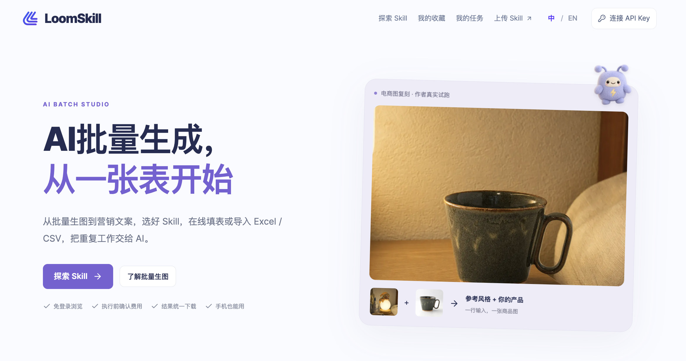
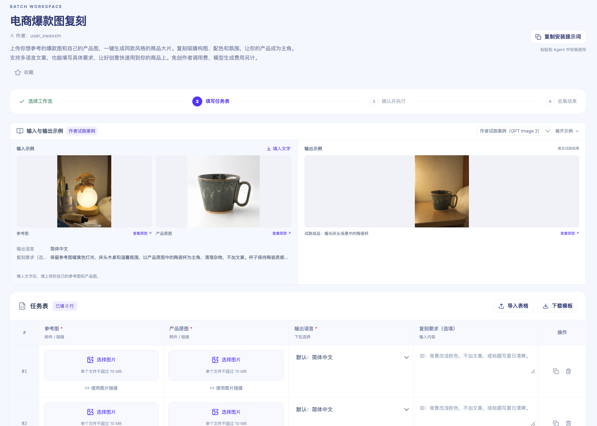
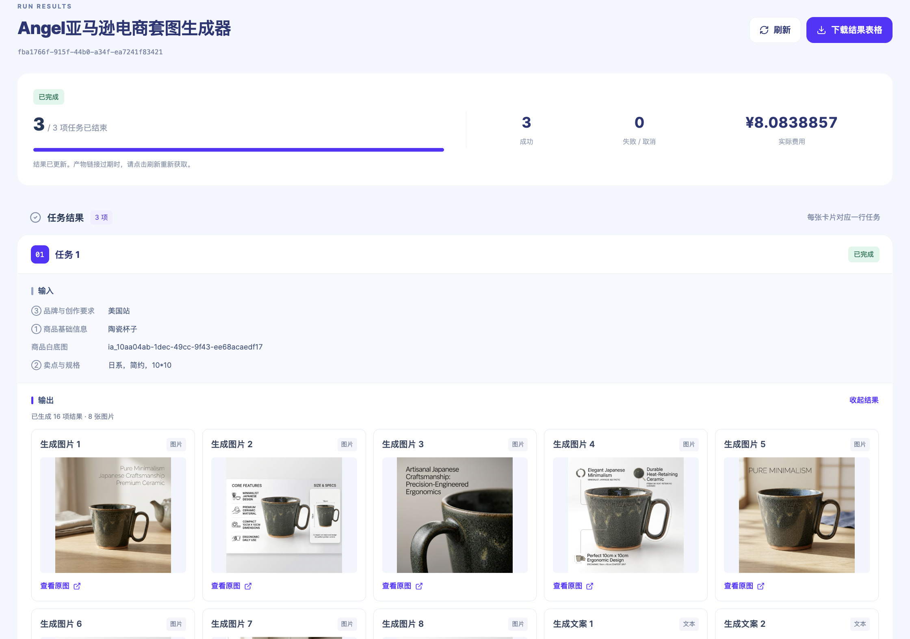
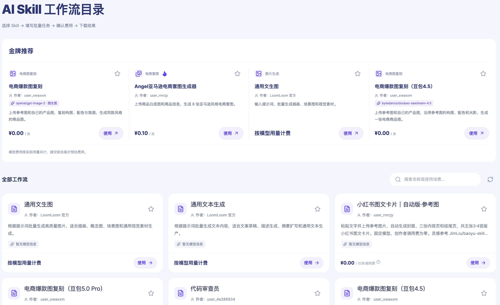
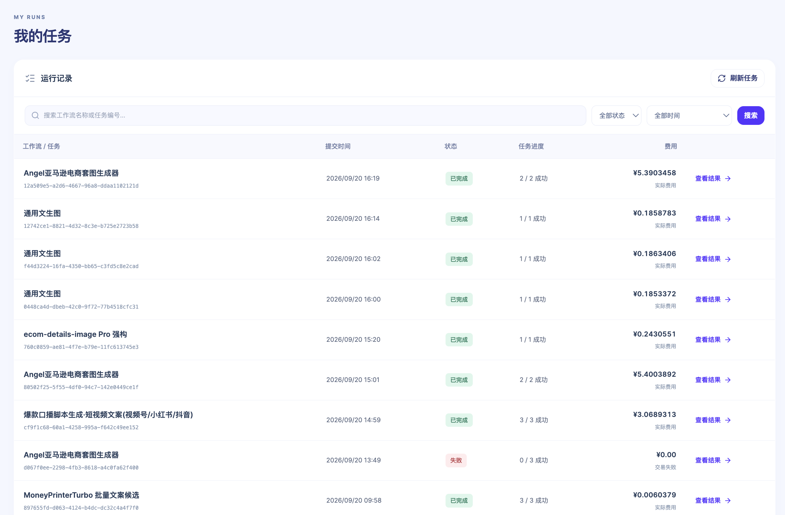

# LoomSkill

**用表格批量运行 AI Skill，生成商品图、插画和文案。**

选择现成的 Skill，或将自己的 Skill 适配、上传并上架后调用。在线填表或导入 Excel / CSV，每行就是一个任务；确认费用后批量提交，在「我的任务」集中查看进度、获取结果。

[在线体验](https://loomskill.com/) · [探索 Skill](https://loomskill.com/skills) · [批量生图场景](https://loomskill.com/batch-image-generation) · [上传自己的 Skill](#上传自己的-skill再批量调用) · [自行部署](docs/SELF-HOSTING.md) · [反馈问题](https://github.com/maimaimangmang/AI-Skill-Batch/issues)



## 可以做什么

- **批量生图**：按行填写提示词，或提供参考图、商品图和画面要求，生成插画、商品场景图、电商套图等素材。
- **批量写文案**：把商品信息、卖点或选题填入表格，调用对应 Skill 生成内容。
- **导入已有表格**：支持 Excel、CSV、TSV，也可以从 Excel 复制多行粘贴；导入时选择行、列并对应输入字段。
- **集中管理任务与结果**：查看执行进度，预览图片、视频、音频和文本，导出结果为 Excel；失败任务可以修改输入后重新提交。
- **批量调用自己的 Skill**：将已有能力适配为 LoomLoom 工作流，上传并完成上架后，在 LoomSkill 中按行填写不同输入，重复运行同一个 Skill。
- **收藏常用 Skill**：连接 API Key 后收藏，方便下次找到并继续使用。

每个 Skill 的输入要求和输出形式不同，以详情页的说明为准。

## 从输入到结果：两种生图场景

### 参考风格，生成自己的商品场景图

「电商爆款图复刻」接收参考图、产品原图、输出语言和可选的画面要求。先看输入与输出示例，再给不同商品逐行准备任务；同一批可以填写不同的图片和要求。

下图展示了参考图、陶瓷杯原图与场景图示例，以及下方待填写的任务表。可以在线添加图片，也可以下载模板后批量导入。



### 提供商品信息，生成电商套图

下面是另一个 Skill「Angel亚马逊电商套图生成器」的运行结果。这批任务共 3 行，页面显示 3 项成功；展开的第一项以陶瓷杯为商品，输出区标明 8 张图片，并包含配套文案。

每行任务可以返回多项内容，不限于一张图片。结果页把输入和对应产物放在一起，方便核对，也可以下载结果表格。



以上分别展示商品图复刻的填写界面和电商套图的运行结果，来自两个不同的 Skill。截图中的模型、价格和费用是当时的页面记录，当前可用选项和费用以执行前的页面信息为准。

<details>
<summary>查看 Skill 目录：选择生图、文案等不同工作流</summary>

目录提供场景介绍、输入输出说明的入口和收藏功能。可以先搜索用途，再进入具体 Skill 查看要求；同名 Skill 也可能来自不同作者或版本，选择时应核对详情。



</details>

<details>
<summary>查看任务管理：集中查看进度、费用与历史结果</summary>

「我的任务」可以按工作流名称或任务编号搜索，并按状态、时间筛选。每批任务显示完成情况和费用，点击「查看结果」进入对应产物页面。任务提交后在云端继续执行，无需一直开着网页等待。



</details>

## 快速上手

1. 打开 [loomskill.com](https://loomskill.com/)，从「探索 Skill」选择一个场景。
2. 查看填写说明，在网页中填写任务表，或下载模板、填写后导入。浏览和填写无需连接 Key。
3. 点击「校验并预估费用」，按提示连接自己的胜算云 API Key，核对任务数量和预计费用。
4. 确认执行后，到「我的任务」查看进度和结果。

**尚未提交的表格草稿只保存在当前页面，关闭或刷新前请另存。**

## 上传自己的 Skill，再批量调用

**除了使用目录里的现成 Skill，你也可以把自己的 Skill 发布为可调用的工作流，再用表格批量执行。** 例如，把已经调好的商品图处理或文案生成流程做成一个 Skill，每行换一组输入，就能集中提交多个任务。

1. **准备输入与输出**：明确每次运行需要哪些文字、图片或参数，以及最终返回什么内容。
2. **适配并上传**：点击网站导航中的「上传 Skill」，前往 [LoomLoom 平台](https://www.shengsuanyun.com/zh/loomloom/)，按平台要求将自己的 Skill 适配为工作流。
3. **测试与上架**：用少量样例检查输出，补充说明、结果示例和调用价格，并完成平台要求的审核与上架。
4. **回到 LoomSkill 批量调用**：在目录中找到已上架的 Skill，在线填写或导入任务表，预估费用并确认执行。

上传、定价、审核和收益管理在 LoomLoom 平台完成，具体规则以平台说明为准。当前 LoomSkill 目录展示已发布、已上架的公开 Skill；本项目暂不提供站内私有 Skill 编辑器或团队协作。

## 在本地运行

需要 Node.js 24 或更新版本。

```bash
git clone https://github.com/maimaimangmang/AI-Skill-Batch.git
cd AI-Skill-Batch
npm ci
npm run setup
npm run dev
```

打开 [http://localhost:3000](http://localhost:3000)，即可浏览 Skill，或连接自己的 Key 使用任务功能。

`npm run setup` 会生成本地配置，不覆盖已有的 `.env.local`。API Key 在网页里输入，无需写进代码或配置文件。使用其他端口时，将 `.env.local` 中的 `APP_ORIGIN` 改为实际访问地址。

Docker 部署、环境变量和存储配置见 [自部署与开发](docs/SELF-HOSTING.md)，Railway 部署见 [Railway 部署指南](docs/RAILWAY.md)。

## 服务依赖与费用

### LoomSkill 与 LoomLoom 的关系

LoomSkill 是接入胜算云 **LoomLoom** 服务的独立开源工作台：任务表填写、批量提交和结果查看在这里完成，Skill 执行由 LoomLoom 云端服务提供。自行部署工作台后，运行真实任务仍需连接该服务，并提供自己的胜算云 API Key。

本仓库开源的是网页工作台；市场中各个 Skill 的内部提示词与工作流编排不包含在仓库内。调用者可以查看公开的输入说明、价格、任务状态和返回结果。

### 使用是否收费

浏览 Skill 和填写任务表不会执行任务。连接 Key、预估费用并确认后，才会提交执行。真实任务可能产生 Skill 调用费和模型费用，以页面预估及胜算云最终结算为准。

### Key 与数据如何保存

API Key 加密保存在部署服务器的会话中，不写入浏览器本地存储；会话最长有效 12 小时，退出连接后删除。请只在可信的部署中输入 Key。

不要将 `.env.local`、`.data`、API Key 或真实任务数据提交到仓库。当前使用 SQLite，按单实例部署；存储与数据处理细节见 [自部署与开发](docs/SELF-HOSTING.md)。

## 开发与贡献

技术栈：Next.js · React · TypeScript · SQLite。

```bash
npm run typecheck
npm test
npm run build
```

测试使用模拟接口，不会提交真实付费任务。开发与配置说明见 [自部署与开发](docs/SELF-HOSTING.md)，浏览器检查步骤见 [QA 文档](docs/QA.md)。

欢迎通过 [Issue](https://github.com/maimaimangmang/AI-Skill-Batch/issues) 反馈问题或提出建议，也欢迎提交 Pull Request。报告问题时，请附上操作步骤、预期结果和实际表现；截图与日志中请去除 API Key 和私人任务数据。

## 许可证

[MIT](LICENSE)。可以修改和自行部署，保留许可证中的版权声明。第三方依赖遵循各自许可证。
